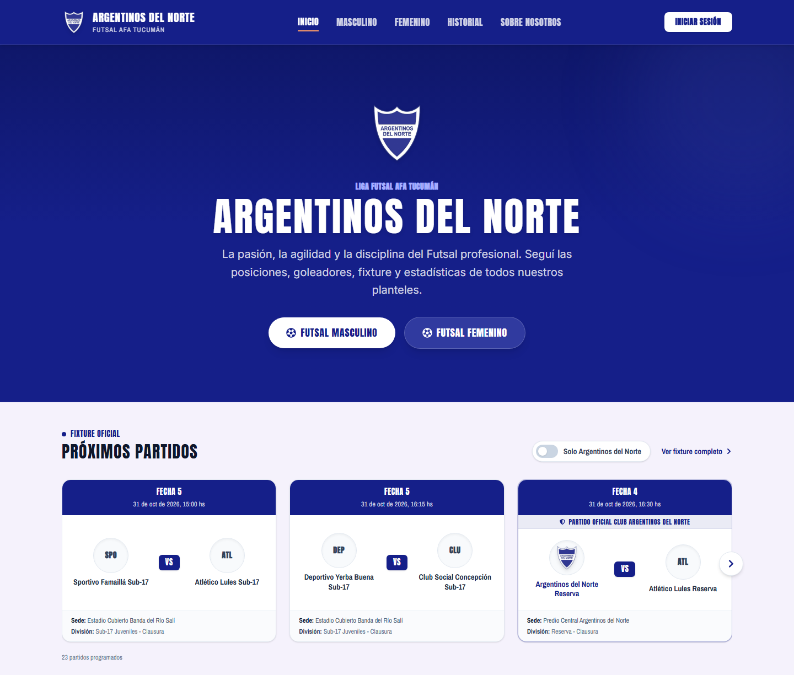
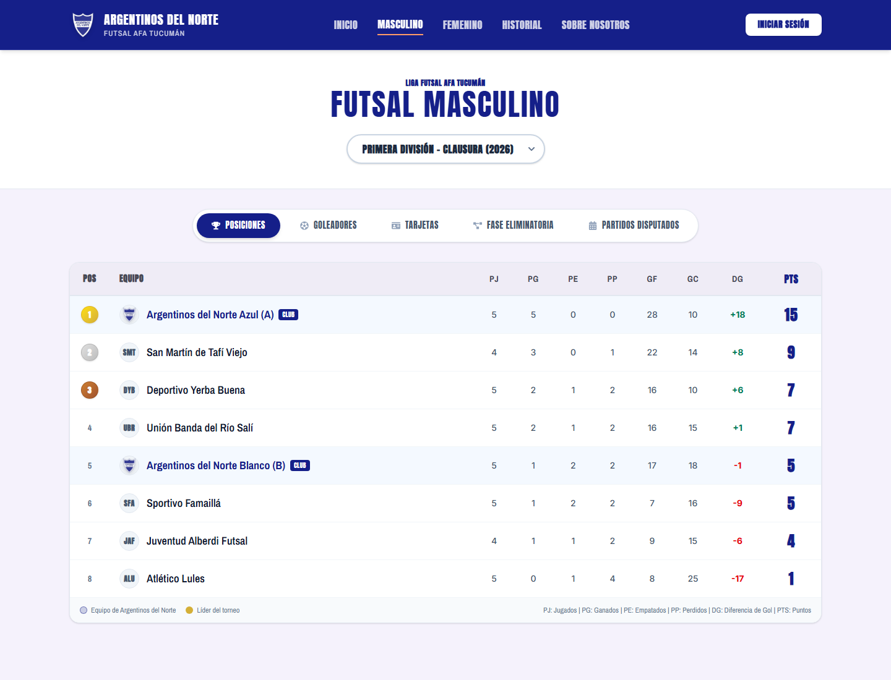
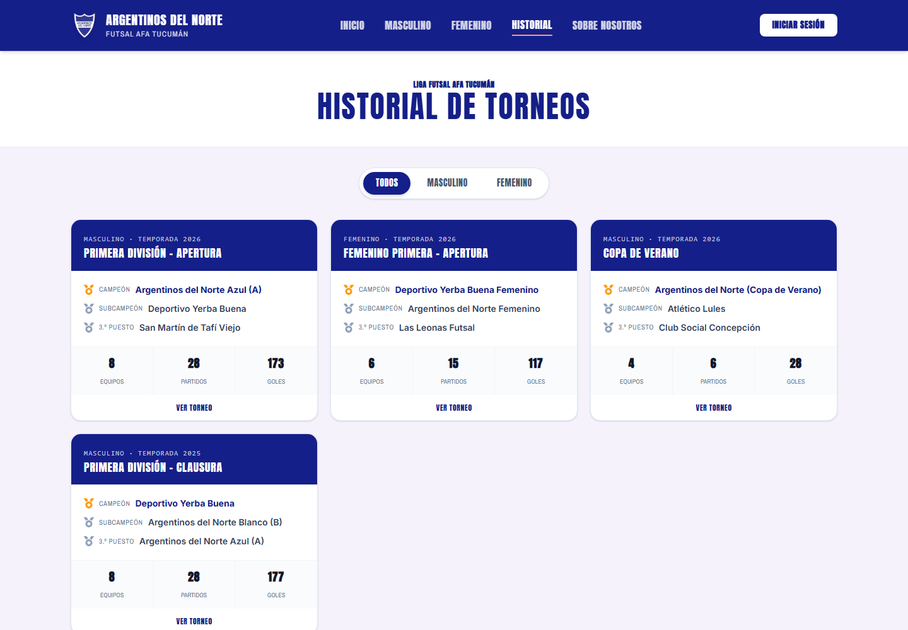
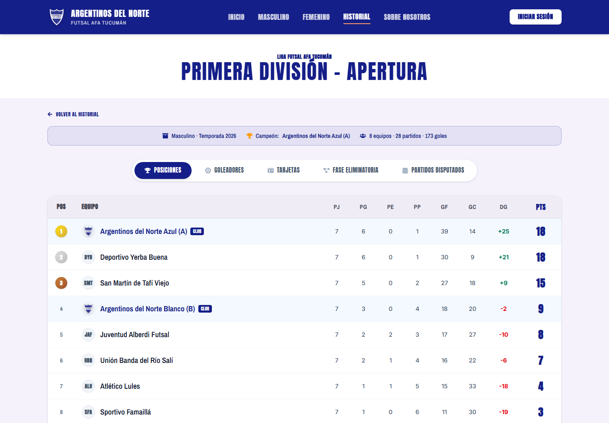
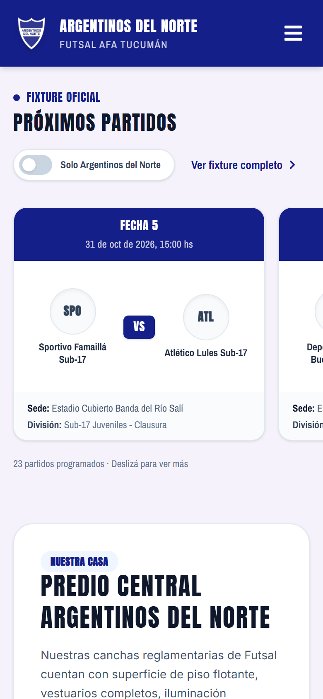
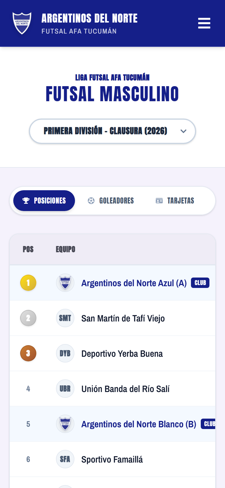
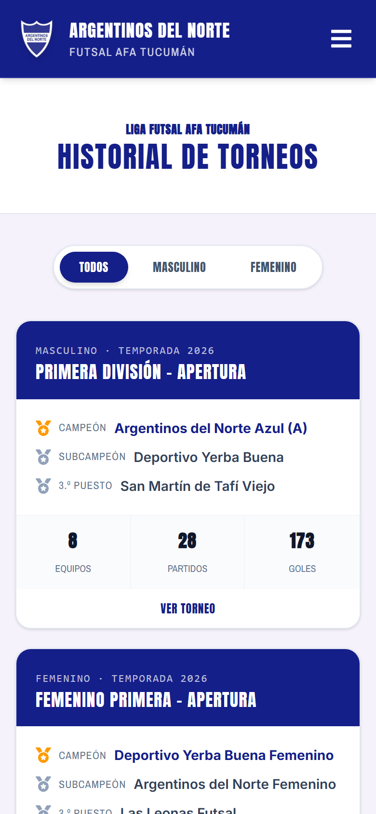
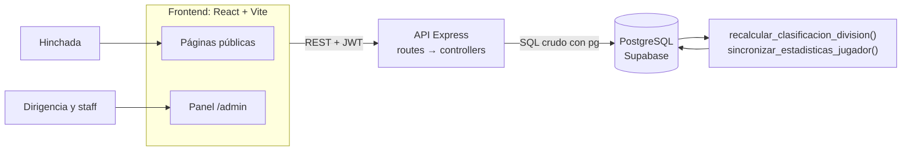
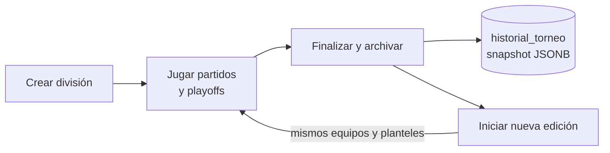

<div align="center">


# Argentinos del Norte

**El sistema de gestión del club de futsal de la Liga AFA Tucumán.**

Fixture, tablas, playoffs y goleadores para la hinchada.
Padrón, planteles, cuotas y caja para la dirigencia.

[](https://github.com/maxip123/Argentinos-app/actions/workflows/ci.yml)


[Qué hace](#qué-hace) · [Capturas](#capturas) · [Arquitectura](#arquitectura) · [Instalación](#instalación) · [API](#api) · [Reglas de negocio](#reglas-de-negocio)



</div>

## Qué hace

### Para la hinchada, sin iniciar sesión

| | |
|---|---|
| **Próximos partidos** | Carrusel con todo el fixture programado y un filtro para ver solo los partidos del club. |
| **Torneos en juego** | Posiciones, goleadores, tarjetas, fase eliminatoria y partidos disputados, por rama y división. |
| **Historial** | Cada torneo terminado queda guardado con su podio, su tabla y sus estadísticas. |
| **Responsive** | Todas las páginas públicas están pensadas para usarse desde el celular. |

### Para el club, desde el panel `/admin`

| Módulo | Qué permite |
|---|---|
| **Torneos** | Crear divisiones, cargar partidos y resultados, cerrar una edición y arrancar la siguiente. |
| **Playoffs** | Armar y jugar las llaves eliminatorias, con un cuadro único o con Copa Oro y Copa Plata. |
| **Equipos** | Gestionar los equipos del club y los rivales, con planteles y cuerpo técnico. |
| **Jugadores** | Padrón completo. Un mismo jugador puede estar en varios equipos del club a la vez. |
| **Finanzas** | Estado de cuotas por jugador, cobros y libro de caja con ingresos y egresos. |
| **Historial** | Consultar y administrar las ediciones archivadas. |
| **Usuarios** | Cuentas y permisos para cada rol del club. |

## Capturas

<table>
  <tr>
    <td width="50%"></td>
    <td width="50%"></td>
  </tr>
  <tr>
    <td align="center"><b>Torneo en juego</b></td>
    <td align="center"><b>Historial de torneos</b></td>
  </tr>
</table>



<p align="center"><b>Detalle de una edición archivada</b></p>

<table>
  <tr>
    <td width="33%"></td>
    <td width="33%"></td>
    <td width="33%"></td>
  </tr>
  <tr>
    <td colspan="3" align="center"><b>En el celular</b></td>
  </tr>
</table>

> Las capturas usan los datos ficticios de [`seed_demo.js`](backend/scripts/seed_demo.js).

## Stack

| Capa | Tecnologías |
|---|---|
| **Frontend** | React 19, Vite 8, Tailwind CSS 4, React Router 7, Zustand, Axios, React Icons |
| **Backend** | Node.js, Express 5, `pg` con SQL crudo, express-validator, JWT, bcryptjs, Helmet |
| **Base de datos** | PostgreSQL en Supabase, con funciones y triggers para los cálculos deportivos |
| **Infraestructura** | Vercel (frontend y backend serverless), GitHub Actions (lint y build del frontend) |

## Arquitectura



La tabla de posiciones no se carga a mano: se reconstruye desde los partidos finalizados. Un trigger sobre `partido` dispara el recálculo, y los goles y tarjetas acumulados de cada jugador se sincronizan desde sus estadísticas por partido.

### Ciclo de vida de un torneo



Al archivar se guarda una foto completa de la edición: tabla, partidos, playoffs, goleadores y tarjetas. Al iniciar la edición siguiente se reutiliza la misma división, así que la temporada anterior pasa a vivir solo en `historial_torneo`.

## Instalación

### Requisitos

- Node.js 20 o superior (el CI usa la 20)
- Un proyecto de [Supabase](https://supabase.com) o una base PostgreSQL propia
- Los archivos `schema_supabase.sql` y `seed_data.sql`

> [!IMPORTANT]
> `schema_supabase.sql` y `seed_data.sql` **no están en el repositorio** porque `.gitignore` excluye `*.sql`. Hay que pedírselos al equipo y copiarlos en la raíz antes de preparar la base.

### 1. Clonar e instalar

```bash
git clone https://github.com/maxip123/Argentinos-app.git
```

```bash
cd Argentinos-app/backend && npm install
```

```bash
cd Argentinos-app/frontend && npm install
```

### 2. Configurar las variables de entorno

Copiá `backend/.env.example` a `backend/.env` y `frontend/.env.example` a `frontend/.env`.

| Archivo | Variable | Descripción |
|---|---|---|
| `backend/.env` | `DATABASE_URL` | Connection string del pooler de Supabase |
| `backend/.env` | `JWT_SECRET` | Clave con la que se firman las sesiones |
| `backend/.env` | `JWT_EXPIRES_IN` | Duración de la sesión, por ejemplo `7d` |
| `backend/.env` | `PORT` | Puerto de la API, por defecto `4000` |
| `backend/.env` | `ADMIN_EMAIL` | Opcional: email del admin para `seed_demo.js` y `test_flow_complete.js` |
| `backend/.env` | `ADMIN_PASSWORD` | Opcional: contraseña del admin para `test_flow_complete.js` |
| `frontend/.env` | `VITE_API_URL` | URL de la API, por defecto `http://localhost:4000/api` |

> [!WARNING]
> Nunca subas tus archivos `.env` ni escribas credenciales en el código. Generá tu propio `JWT_SECRET` con el comando de abajo.

```bash
node -e "console.log(require('crypto').randomBytes(48).toString('hex'))"
```

### 3. Preparar la base de datos

Desde `backend/`, este script aplica el esquema y los datos iniciales, incluido el usuario administrador:

```bash
node scripts/run_schema_and_seed.js
```

### 4. Levantar el proyecto

Cada comando va en su propia terminal:

```bash
cd backend && npm run dev
```

```bash
cd frontend && npm run dev
```

El frontend queda en <http://localhost:5173> y la API en <http://localhost:4000/api/health>.

### Datos de demo (opcional)

Para ver el sistema como si ya estuviera en uso, este script carga una temporada completa: 5 divisiones, 59 jugadores, torneos archivados, torneos en juego, cuotas y más de 500 movimientos de caja. Al terminar verifica que goles, tablas, cuotas y caja cierren entre sí.

> [!CAUTION]
> `--reset` **borra todos los datos de la base** apuntada por `DATABASE_URL`, y solo conserva el usuario administrador. No lo corras contra una base con datos reales.

```bash
cd backend && node scripts/seed_demo.js --reset
```

## Comandos

| Dónde | Comando | Qué hace |
|---|---|---|
| `backend/` | `npm run dev` | API con recarga automática en el puerto 4000 |
| `backend/` | `npm start` | API sin recarga automática |
| `frontend/` | `npm run dev` | Servidor de desarrollo de Vite en el puerto 5173 |
| `frontend/` | `npm run build` | Build de producción |
| `frontend/` | `npm run lint` | Lint con oxlint |

El proyecto no tiene una suite de tests automatizados. El CI corre lint y build del frontend, y `backend/scripts/test_flow_complete.js` es una prueba manual de punta a punta contra la base real.

## API

Todas las rutas cuelgan de `/api` y responden con el mismo formato:

```json
{ "ok": true, "mensaje": "Operación exitosa", "data": {} }
```

| Recurso | Ruta | Contenido |
|---|---|---|
| Autenticación | `/api/auth` | Login, perfil, contraseña y usuarios |
| Divisiones | `/api/divisiones` | Torneos, archivado, nuevas ediciones e historial |
| Equipos | `/api/equipos` | Equipos y planteles |
| Jugadores | `/api/jugadores` | Padrón del club |
| Partidos | `/api/partidos` | Fixture, resultados y estadísticas |
| Clasificación | `/api/clasificacion` | Tablas de posiciones |
| Playoffs | `/api/playoff` | Llaves eliminatorias |
| Cuerpo técnico | `/api/cuerpo-tecnico` | Staff de cada equipo |
| Sedes | `/api/sedes` | Canchas y predios |
| Cuotas | `/api/cuotas` | Estado de cuotas y cobros (requiere sesión) |
| Caja | `/api/gastos` | Libro de caja y resumen mensual (requiere sesión) |

### Roles

Las consultas de datos deportivos son públicas. Para el resto, la API valida el token y el rol en cada ruta.

`Superadmin` · `Administrador` · `Tesorero` · `Delegado` · `DT` · `Visor`

## Estructura

```text
Argentinos-app/
├── backend/
│   ├── config/         # Conexión a PostgreSQL y transacciones
│   ├── controllers/    # Lógica de cada recurso
│   ├── middlewares/    # Autenticación, roles y validación
│   ├── routes/         # Endpoints de Express
│   ├── scripts/        # Seeds, migraciones y chequeos
│   └── utils/          # Respuestas y validadores
├── frontend/
│   ├── public/         # Escudo y recursos estáticos
│   └── src/
│       ├── api/        # Cliente Axios con JWT
│       ├── components/ # UI pública y módulos del panel
│       ├── pages/      # Inicio, torneo, historial, admin...
│       ├── stores/     # Estado global con Zustand
│       └── utils/      # Fechas en hora del club
└── docs/screenshots/   # Capturas de este README
```

## Reglas de negocio

- **Solo se cargan datos individuales del club.** Los rivales aparecen en el fixture, los resultados y la tabla, pero sin plantel ni estadísticas por jugador.
- **Un jugador puede estar en varios equipos del club.** La relación vive en `equipo_jugador`.
- **Los borrados son lógicos.** Los registros se marcan con `activo = FALSE` en lugar de eliminarse.
- **El historial es permanente.** Cada torneo archivado conserva su tabla y sus estadísticas.
- **Las fechas se muestran en hora del club.** Todo se ve en hora de Tucumán (UTC−3), sin importar desde dónde se abra.

## Cómo contribuir

Se trabaja sobre la rama `dev` y se integra a `main` por pull request. El código, la interfaz y los commits van en español, con prefijo convencional:

```text
feat(ui): carrusel de próximos partidos con filtro del club en el inicio
fix(cruds): validar el DNI al editar un jugador
```

Antes de abrir un PR, corré `npm run lint` y `npm run build` en `frontend/`.

---

<div align="center">

**Club Atlético Argentinos del Norte** · San Miguel de Tucumán

© Club Atlético Argentinos del Norte. Todos los derechos reservados.

</div>
